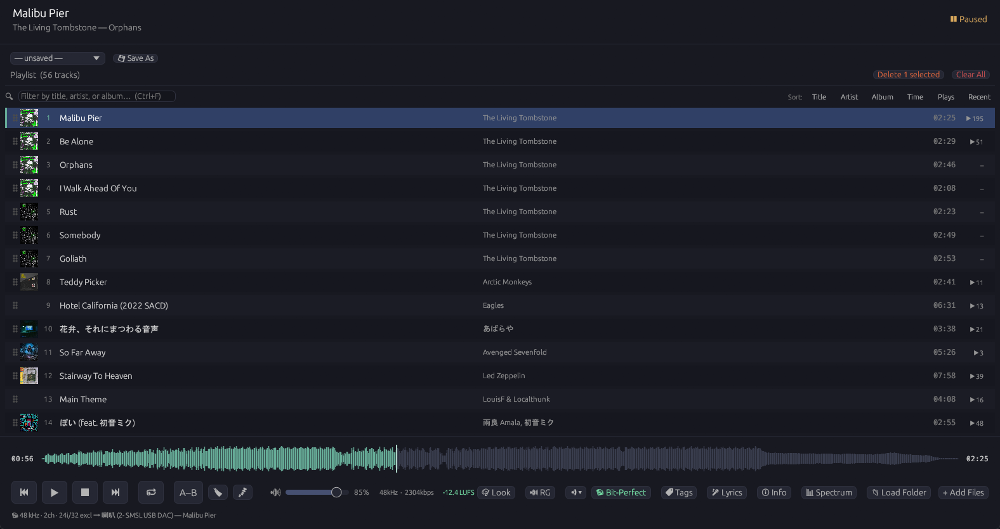
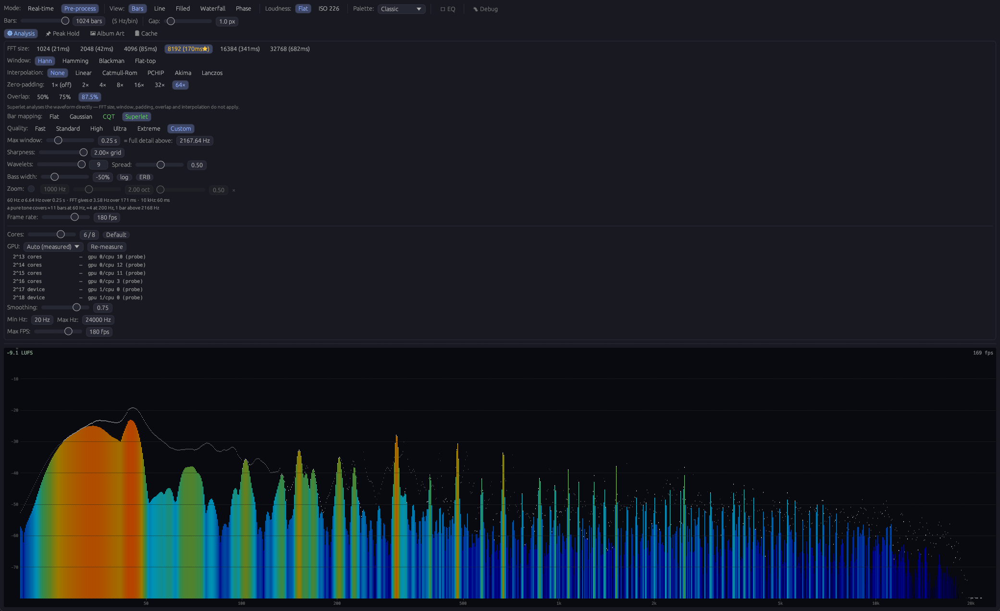

# Moosik

<p align="center">
  
</p>

A desktop music player with bit-perfect output (PCM and DSD), a
professional-grade spectrum analyzer, and a parametric EQ, built in Rust.

<p align="center">
  
</p>

<p align="center">
  
</p>

## Build

**Current release: [1.5.4](https://github.com/HenloAmHorse/Moosik-Player/releases/tag/v1.5.4).**
Download the Windows x86_64 `.exe` and the accompanying notices. There is no
installer; local translation models are optional, separate downloads.

Requires Rust (stable, edition 2024). Tagged releases attach a prebuilt Windows
x86_64 executable (it needs the Microsoft Visual C++ 2015-2022 Redistributable,
x64, which most Windows PCs already have); on other platforms, building it is
how you run it.

On Linux, the audio backend (cpal/ALSA) needs the ALSA development headers:

```sh
sudo apt install libasound2-dev   # Debian/Ubuntu
```

Then:

```sh
git clone https://github.com/HenloAmHorse/Moosik-Player
cd Moosik-Player
cargo build --release --locked
./target/release/moosik
```

`--locked` builds exactly the dependency versions in `Cargo.lock`. Three crates
are built from the copies under `vendor/` (`eframe`, `egui`, `rustfft`); each
has a `PATCH.md` saying what differs from the published release and why. The
first build downloads the other crates, and `lindera`'s build script downloads
and compiles the Japanese (IPADIC) dictionary. To build again without a
network: run `cargo fetch --locked` once, set
`LINDERA_BUILD_DICTIONARY_CACHE_DIR` to a directory of your choice for that
first build so the compiled dictionary is kept there, and later build with
`--locked --offline` and the same variable.

## What it does

- **Bit-perfect output** — the sample words handed to the driver are the
  source's own, unmodified. Exact formats only: a 24-bit file never negotiates a
  16-bit one, and if no format can carry the source the open fails with the
  reason instead of quietly converting
- **DSD** — `.dsf` and `.dff` as first-class formats, over DoP or native ASIO
  (Windows) and ALSA (Linux)
- **Spectrum analyzer** — pre-processed and real-time visualisation,
  frequency-dependent adaptive superlet analysis, GPU offload, and
  per-channel views including a left/right difference
  plot. Channels work from the cache as well as live: a stereo analysis derives
  the mix from the two channels' complex responses rather than analysing it a
  third time, and stores them with the analysis
  ([docs/SPECTRUM.md](docs/SPECTRUM.md)). Pre-processing a track is the
  heaviest thing Moosik does, and recent work has gone into making it cost less
  CPU and hold less memory while producing exactly the same output — see the
  changelog for what was measured and what it covers. **Whole track** adds
  exact stored-cell time-frequency inspection, zoom/pan, playback follow,
  click-to-seek and middle-click fit. Pending views retain the previous
  complete picture and coordinates until a coherent replacement is ready
- **Analysis cache** — a finished analysis is reused only for the same file
  (path, size, modified time and a content sample) at the same settings, and is
  saved as one whole, so a crash never leaves the spectrum and its channels out
  of step; what is on screen is never deleted to make room. Analyses from older
  versions are kept and offered only as labelled alternatives. The guarantees
  and their limits are in [docs/CACHE.md](docs/CACHE.md)
- **Parametric EQ** — up to 16 bands, dragged directly on the spectrum, with
  global and per-song presets
- **Lyrics** — synced `.lrc`, read from the file or looked up online, with a
  tap-along editor and karaoke highlighting where the sheet times its words.
  Japanese lyrics can be shown in romaji, with furigana, or both, word by word.
  Readings come from the lyrics source or are generated, and furigana written
  into the lyrics takes precedence unless you confirm otherwise. Korean lyrics
  also have offline, correctable romanization. Chinese translations can be
  supplied by the source, supplemented on request, manually edited, or generated
  on request for Japanese/Korean/English; generated results require a preview
  and explicit adoption. Traditional/Simplified display is available. Online
  translation sends lyric text to a third party only after consent; it is not
  confidential processing. An optional context-aware AI translation uses your
  own OpenAI API key (off until configured; its translation quality has not
  been evaluated). Downloadable local models need no API key; their output
  also requires preview and explicit adoption. Hy-MT2 30B has an experimental
  lower-RAM GPU route (16 GiB available RAM, 21 GiB commit headroom and a
  7+ GiB dedicated graphics card). Smaller models remain available for more
  modest hardware. The local workbench supports custom instructions, seeded
  alternative drafts, feedback revisions, locked rows, eight session draft
  versions, selective adoption and one-step undo. Feedback does not train the
  model. Never writes to the audio file
- **Tag editing** — with verified, non-destructive writes
- **The rest** — gapless playback, ReplayGain, album-art overlays and mask mode,
  A-B repeat, bookmarks, sleep timer, play statistics, OS media keys, LUFS and
  correlation metering, and a light or dark theme that takes its accent from the
  cover art

### What "bit-perfect" claims here

The words Moosik hands the audio driver are the source's own. That is the whole
claim. The USB link, the driver's internals and the DAC are past the boundary of
anything this process can observe — a DAC's rate display and its lock light are
not evidence. Verifying the physical end of the chain needs capture equipment on
the link, and nothing in Moosik has been validated that way.

The four states this distinguishes, and the rules for each, are in
[docs/BIT_PERFECT.md](docs/BIT_PERFECT.md).

## Planned

Directions, not commitments — none of this is implemented, and nothing below
describes what the current release does.

| | |
|---|---|
| **1.5.5** | A true constant-Q transform and further measured pre-process/real-time performance work; the current constant-Q weighting remains FFT-based. |
| **1.6.0** | Professional audio-analysis features. Harmonic and pitch analysis, time-frequency inspection and channel-analysis tools are candidate directions. |

Principles that work is meant to hold to:

- Bit identity of *intermediate* results is not required everywhere; identity of
  what is defined as the reference output is.
- Optimising the visualisation path means reproducing a defined reference
  output — including the relevant temporal state and the supported display
  changes — not looking similar in one screenshot.
- Planning that adapts to the screen must never quietly weaken the reference
  analysis.
- A professional-analysis result must not depend on monitor or window size.
- Display caches are not assumed to hold everything a future analytical feature
  needs: reuse work that is compatible, and support re-analysis from the source
  when it is not.

## Reading further

| | |
|---|---|
| [docs/BIT_PERFECT.md](docs/BIT_PERFECT.md) | the exactness contract in full, and DSD |
| [docs/SPECTRUM.md](docs/SPECTRUM.md) | the analyser, the superlet transform, and the EQ |
| [docs/CACHE.md](docs/CACHE.md) | the analysis cache: what it guarantees, what it does not, and older versions' files |
| [docs/RELEASE_COMPARISON_153.md](docs/RELEASE_COMPARISON_153.md) | 1.5.3 measured against 1.5.2.1: pre-processing time, CPU, memory, and loading a saved analysis |
| [THIRD_PARTY_NOTICES.txt](THIRD_PARTY_NOTICES.txt) | third-party licenses and notices for the Windows executable ([how they were assembled](docs/THIRD_PARTY_NOTICES.md)) |
| [docs/FEATURES.md](docs/FEATURES.md) | album art, lyrics, tags, appearance, player |
| [docs/ICON.md](docs/ICON.md) | what the icon is |
| [CHANGELOG.md](CHANGELOG.md) | what changed, and why |

## Platform Support

"Status" here means what has actually been run, which is not the same as what
is believed to work.

| Platform | Status | Output backend | Exactness claimed |
|---|---|---|---|
| Windows | Builds, tests pass, hardware-verified for native ASIO DSD | WASAPI exclusive mode; native ASIO DSD | Yes — as far as the audio driver |
| Linux | Builds and tests pass; no DAC exercised | cpal (a direct ALSA `hw:` device avoids the mixing shims); native ALSA DSD | No — reported as *unverified*, because the platform route is not observable from here |
| macOS | Neither built nor tested | cpal — exact format requested, CoreAudio device behaviour decides the rest | No — same reason |

## Dependencies

All pulled automatically via Cargo:

| Crate | Purpose |
|---|---|
| `eframe` / `egui` | Immediate-mode GUI |
| `rodio` | Audio playback (normal mode) |
| `cpal` | Direct device output (bit-perfect mode, Linux/macOS) |
| `wasapi` | WASAPI exclusive-mode output (bit-perfect mode, Windows) |
| `symphonia` | Audio decoding (MP3, FLAC, OGG, WAV, AAC, …) |
| `rtrb` | Lock-free ring buffer (decode → output) |
| `rustfft` | FFT engine |
| `wgpu` / `pollster` / `bytemuck` | GPU compute for the superlet pre-process |
| `rayon` | Parallel analysis |
| `lofty` | Tag / metadata reading |
| `souvlaki` | OS media-key / now-playing integration (MPRIS / SMTC / macOS) |
| `image` | Album art decoding |
| `serde` / `serde_json` | Preset / settings persistence |
| `lz4_flex` | Analysis cache compression |
| `ring` | SHA-256 for the analysis cache's identity (already in the build through `ureq`'s TLS) |
| `ureq` | HTTPS for lyrics lookup and on-request translation |
| `lindera` | Japanese readings (embedded IPADIC dictionary) |
| `ferrous-opencc` | Traditional/Simplified Chinese display conversion |

## License

GNU Affero General Public License v3.0 — see [LICENSE](LICENSE).
